### Linux File System Management and Command-Line Operations

1. Project Overview

This project demonstrates practical Linux command-line skills through a series of file-system management exercises.

The objective is to understand how Linux handles files, directories, permissions, symbolic links, hard links, archiving, extraction, and file searching.

The project consists of 20 practical tasks performed using Linux commands in a terminal environment.

### Project Objectives

- Navigate and manage directories using Linux commands.

- Create, copy, move, and delete files.

- Understand Linux file permissions.

- Create and manage symbolic links and hard links.

- Work with hidden files and directories.

- Archive and extract files using tar.

- Search for files based on names and modification dates.

- Search file contents using grep.
### Tools and Technologies

| Tool | Purpose |
|---|---|
| `Linux` | Operating system and command-line environment |
| `Git Bash` | Linux-style terminal on Windows |
| `Bash` | Command-line shell |
| `GNU Coreutils` | File and directory operations |
| `GNU tar` | Archiving and extraction |
| `find` | File searching |
| `grep` | Searching file contents |

### 2. Project Environment Setup

Open Git Bash or a Linux terminal.

#### Step 1: Check the Present Working Directory

pwd

#### Explanation:
 pwd means Print Working Directory. It displays the directory you are currently working in.

### Step 2: Create and Enter the Project Directory

mkdir advanced_directory
cd advanced_directory

#### Explanation:
```
mkdir creates a new directory.
```
cd changes the current working directory.

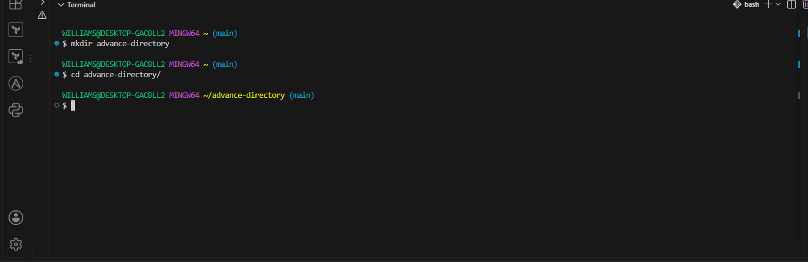


### Step 3: Create Two Files and Display Detailed Information

touch file_a.txt file_b.txt
ls -l

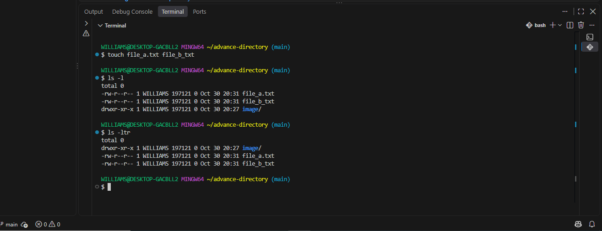
Explanation:

- touch creates empty files.

ls -l 

- displays files with detailed information, including permissions, ownership, size, and modification date.


### Step 4: Create a Symbolic Link

ln -s file_a.txt link_to_file_a

Explanation: ln -s creates a symbolic link (soft link) pointing to another file.

A symbolic link behaves like a shortcut. It points to the original file rather than sharing its inode.

Verify the link:

ls -l

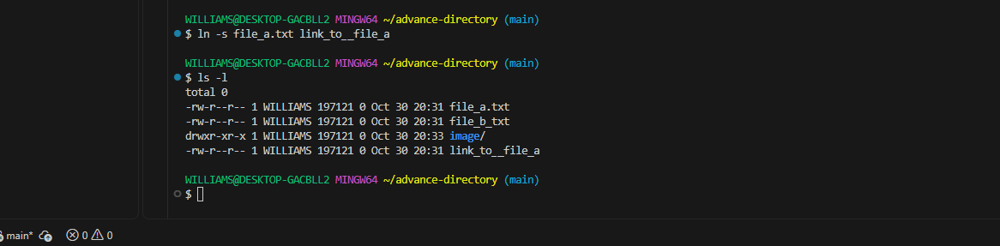

#### Step 5: Change File Permissions

chmod 644 file_b.txt

### Explanation: The command changes the permissions of file_b.txt.

Permission breakdown:
```
chmod 644 file_b.txt
```
Explanation: The command changes the permissions of file_b.txt.

Permission breakdown:
| Permission | Value | Meaning |
|---|---:|---|
| Owner | `6` | Read and write |
| Group | `4` | Read only |
| Others | `4` | Read only |

The resulting permission is:

-rw-r--r--

The owner can read and modify the file, while other users can only read it.


### Step 6: Create a Nested Directory and Copy Both Files

mkdir nested_directory
```
cp file_a.txt file_b.txt nested_directory/
```
#### Explanation:

- mkdir creates a directory inside the current directory.

- cp copies both files into the new directory.

Verify:

ls -l nested_directory

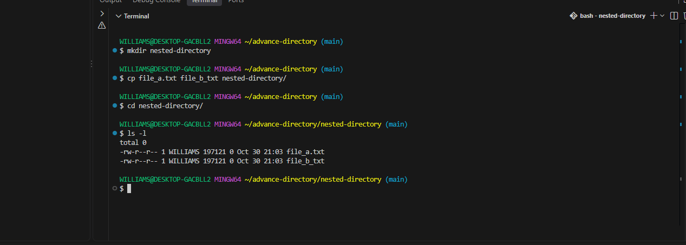


### Create a File and Write Text into It

- Navigate into the nested directory:

- cd nested_directory

- Create secret.txt and write text into it:
```
echo "Hello World" > secret.txt
```
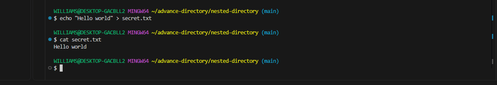

#### Explanation:

echo displays text.

> redirects the text into a file.

If the file does not exist, it is created automatically.

Verify:
```
cat secret.txt
```
Expected output:

``
Hello World
``
### Step 8: Move Both Files Back to the Parent Directory
```
mv -f file_a.txt file_b.txt ..
```
#### Explanation:

- mv moves files from one location to another.

- .. represents the parent directory.

- -f allows replacement of existing destination files without an interactive overwrite prompt.

- Return to the parent directory:

- cd ..

### Step 9: Create a Hidden File

touch .hidden_file

#### Explanation: 
In Linux, filenames beginning with a dot (.) are hidden by default.

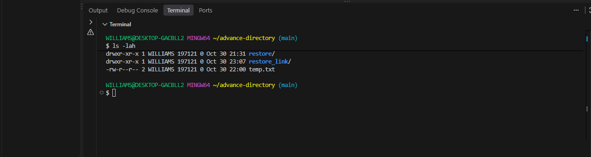

#### Step 10: Display All Files, Including Hidden Files
```
ls -lah
```
#### Explanation:

- -l displays detailed information.

- -a displays hidden files.

- -h displays human-readable file sizes such as KB and MB.
  


### Step 11: Create a Backup Directory and Archive the Project

  ### First, create the backup directory:

- mkdir backup

#### Now archive the contents:
```
   tar -cvf backup/archive.tar --exclude='./backup' .
```
#### Explanation:

  Option                   Meaning

-   tar                     Archive utility

 -  -c                      Create a new archive

  - -v                     Display files being archived

 - -f                        Specify the archive filename

- --exclude                Exclude a specified directory

.                        Include the current directory's contents

The backup directory is excluded because the archive is being created inside it. This prevents the archive from attempting to include itself.

The archive includes hidden files because the command archives . rather than using a wildcard such as *.

#### Step 12: Extract the Archive

- Create a restore directory:

- mkdir restore

- Extract the archive:

```
tar -xvf backup/archive.tar -C restore
```
#### Explanation:

- -x extracts files.

- -v displays extracted files.

- -f specifies the archive.

- -C specifies the extraction destination.

Verify the extracted contents:
``
ls -lah restore
``
### Step 13: Create a File and a Hard Link
```
touch temp.txt
ln temp.txt hard_link_to_temp
```
#### Explanation:

- touch creates temp.txt.

- ln creates a hard link to the same underlying file.

- Unlike a symbolic link, a hard link points to the same inode as the original file. Both names reference the same underlying data.

Verify:
```
ls -li temp.txt hard_link_to_temp
```
Both files should display the same inode number.
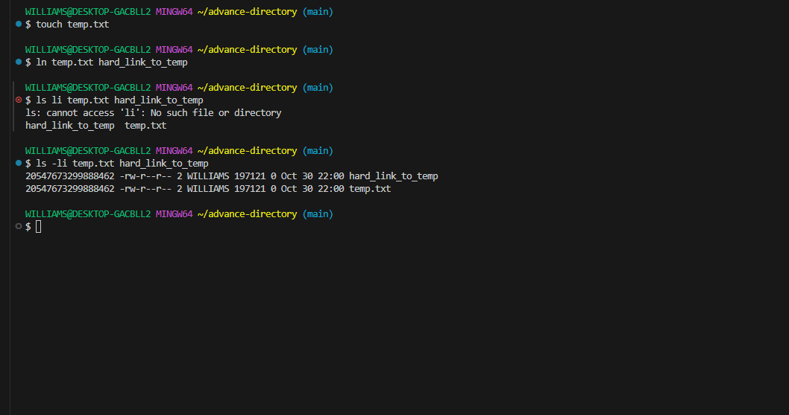


### Step 14: Find All .txt Files

```
find . -type f -name "*.txt"
```
#### Explanation:

- find searches for files and directories.

- . starts the search in the current directory.

- -type f restricts results to regular files.

- -name "*.txt" searches for filenames ending in .txt.

The command searches the current directory and all its subdirectories.

### Step 15: Delete the Backup and Text Files in the Restore Directory

```
rm -rf backup && find restore -type f -name "*.txt" -delete
```
#### Explanation:

First command:

- rm removes files and directories.

- -r recursively removes directory contents.

- -f forces removal without confirmation.

Second command:

- find restore searches inside the restore directory.

- -type f selects regular files.

- -name "*.txt" selects text files.

- -delete deletes matching files.

The && operator ensures the second operation runs only if the first succeeds.

### Step 16: Create a Symbolic Link to the Restore Directory
```
ln -s restore restore_link
```
#### Explanation:
 This creates a symbolic link named restore_link that points to the restore directory.

Verify:

```
ls -l
```

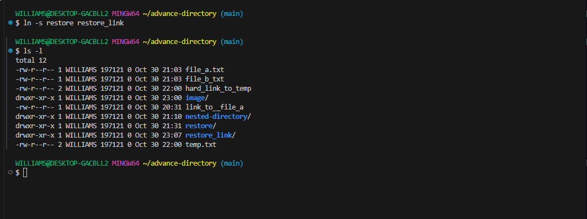

### Task 17: Find Files Modified Within the Last Seven Days

```
find . -type f -mtime -7 -print
```
Explanation:

find searches recursively.

- -type f selects regular files.

- -mtime -7 selects files modified less than seven 24-hour periods ago.

- -print displays their paths.
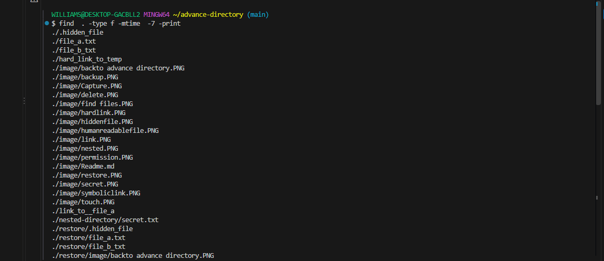

### Step 18: Search for "Hello World" in All .txt Files

```
grep -Rni --include="*.txt" "Hello World" .
```
#### Explanation:

Option       Meaning

grep          Searches text inside files

-R            Searches recursively

-n           Displays matching line numbers

-i           Ignores letter case

--include     Restricts the search to specified filenames


"Hello World"     Text being searched

.              Starts searching in the current directory

This command searches all matching .txt files in the project and its subdirectories.

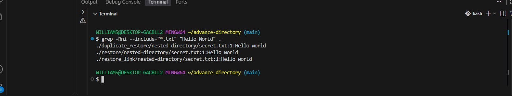

#### Task 19: Rename secret.txt to hidden_secret.txt
The instruction says to rename the file without changing directories.

You can do this using the mv command with the full relative path:

```
mv nested-directory/secret.txt nested-directory/hidden-txt
```

### Explanation:
- mv renames or moves files.
- First path identifies the existing file.
- Second path specifies its new name.
- Both paths point to the same directory, so the file doesn't change location.
Verify:

```
ls
```

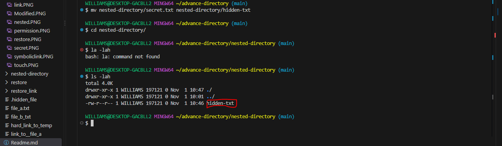

### Task 20: Copy the Entire Restore Directory
Run this in your directory

```
cp -r restore duplicate_restore
```

#### Explanation:
- cp means copy.
- -r means recursive.
- restore is the original directory.
- duplicate_restore is the new directory.
The -r option ensures that all files and subdirectories inside restore are copied.

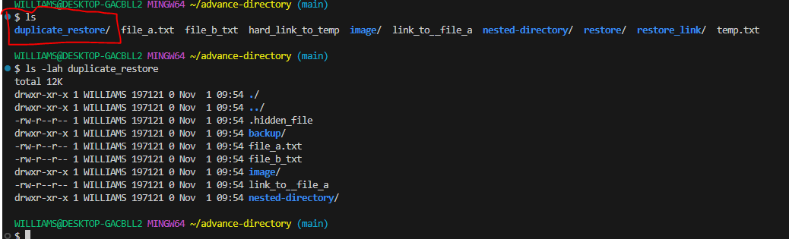
